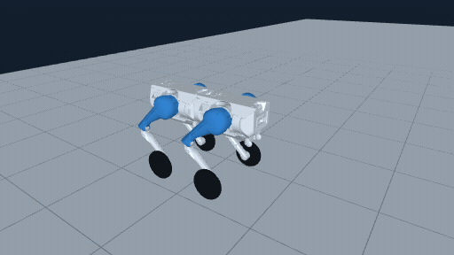
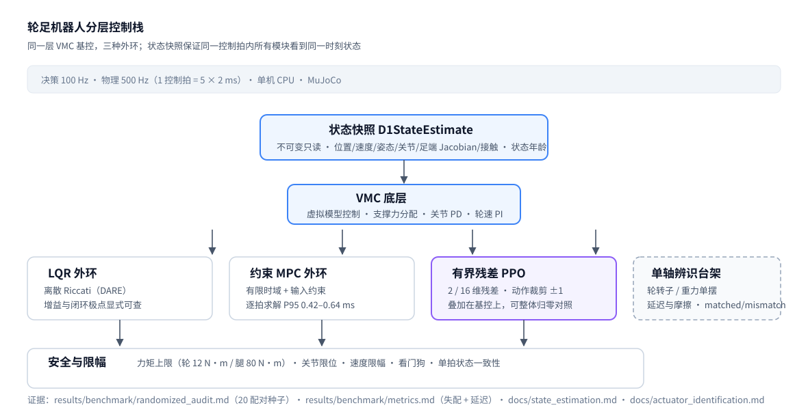

# 求职向概览：Wheel-Legged Control Lab（机器人控制方向）

> 给招聘方/面试官的 2 分钟入口。实验细节在 `docs/`，这里只放结论、证据和边界。
> 每条结论都能在本仓库找到可核验的运行记录；面试时只讲自己能讲清机制的部分。

## 一句话

为 16 自由度轮足机器人建立 VMC 基控上的 **LQR / 约束 MPC / 有界残差 PPO** 分层控制栈；另在平面 6 状态模型上，用 20 个配对评测种子比较模型失配与延迟下的控制表现。全机与平面结果分别报告。

## 看控制过程

| 完整直行与停车 | 完整双向转向与停车 |
|---|---|
|  |  |

C31 完整归档的 B22 + C18 原策略示例，各 16 秒；无 UI、无加速剪辑，GIF 小于 3 MB。这里只展示已记录的仿真行为；停车不归功于 RL，不据画面新增性能结论。[来源、帧数与 SHA](reports/showcase49_results_20261022.json)

[50 后续验证](docs/optimization50_delivery_20261024.md)：腿部 PD 输入消融的共同完整配对 RMSE 恶化 18.66%，候选拒绝；探索标准差减半的三 seed 配对计划在首基线因系统内存压力中断，0/6 完整，不能给出训练效果结论。已有演示策略未替换。

## 60 秒版本

- 平面 6 状态模型（3 关节、2 执行器）：20 个配对种子下，**约束 MPC 相对 LQR 统计上无差别**（平均回报同为 0.783，速度 RMSE 差 0.002，而标准差是 0.16），代价是每拍 **0.42–0.64 ms** 求解时间；LQR 求解时间为 0。
- **模型失配 + 延迟**场景是分水岭：两个经典控制器的高度 RMSE 同时劣化到 **125 mm**，叠加 2 维有界残差的 LQR 守住 **33.8 mm**。
- 把同一思路扩到 23 nq 全机（16 维残差）后，预注册贡献门**没有通过**（pooled SSE 1.039，1/6 项满足）；我把它如实记为负结果，并据此得到"课程更好 ≠ RL 超过基控"的归因边界。
- 诊断驱动的偏航前馈（基控改进）把六任务合池跟踪 SSE 降低 **28.2%**，转向任务降至 0.18×，非转向任务逐位不变。

## 控制栈

核心约定：**一次控制拍只生成一份只读状态快照**，VMC、LQR、MPC、残差策略与安全模块共用同一时刻数据；支持真值与带噪声/延迟两种来源，并记录状态年龄。

## 可核验结果（控制优先）

| 结果 | 数字 | 证据 |
|---|---|---|
| 三种外环对照 | LQR 回报 0.783±0.050、MPC 0.783±0.050、LQR+残差 PPO **0.881±0.034**；高度 RMSE 99.28 → **22.38 mm**；20 配对种子、0 失败 | `results/benchmark/randomized_audit.md` |
| 模型失配 + 延迟 | LQR/MPC 高度 RMSE 125.23 mm；LQR+残差 **33.76 mm**；MPC 求解 P95 0.637 ms | `results/benchmark/metrics.md` |
| 全机 16 维残差 | pooled SSE **1.0388**（比零残差差 3.9%）、逐项 1/6；贡献门 **false** | `docs/main_route_execution_20260930_22.md` |
| 偏航前馈（基控） | 六任务合池 SSE 57.69 → **41.41（−28.2%）**；转向 19.93 → **3.65（0.18×）**；零指令任务逐位不变 | `docs/b22_yaw_feedforward44_results_20261018.md` |
| 融合状态延迟补偿（候选拒绝） | 离线 pitch RMSE −12.62%；闭环两臂各 4/6 跑满，共同完整配对速度 RMSE **+16.84%**，超过 5% 门；保留 4 个跌倒回合，停止完整矩阵 | [49 结果](docs/experiments49/estimator_results49.md) |

另两项[单变量预检](docs/control_candidates49_results_20261022.md)也被拒绝：合成平面 MPC 的高度权重翻倍只改善失配高度误差 0.14%；合成轮轴 PI 的前馈乘 0.75 虽减少饱和 11–12 个百分点，却使跟踪误差增加 19–20%。24 场完整、三个配对 seed，均未进入正式对照。

## 控制技能映射

| 技能 | 在本仓库的落点 |
|---|---|
| 状态空间建模与线性化 | `linear_model.py`、`model.py`：绕直立工作点线性化，得到 A/B |
| 最优控制（LQR） | `solve_discrete_are` 求 Riccati，增益与闭环极点显式计算 |
| 约束优化（MPC） | `LinearMPCController`、`D1MPCVMCController`：有限时域 + 输入约束，逐拍求解并记录 P95 |
| VMC / 接触分配 | `D1VMCController`、`contact_allocation.py`：支撑力分配与虚拟力映射 |
| 逆动力学与力矩控制 | `inverse_dynamics.py`、`wheel_leg_controller.py`：PD + 轮速 PI + 力矩限幅 |
| 状态估计与传感器路径 | `state_estimation.py`、`sensor_estimation.py`：不可变快照、噪声/延迟来源、状态年龄 |
| 执行器辨识 | `docs/actuator_identification.md`：单轴台架、延迟/摩擦、matched/mismatch 留出 |
| 实时约束与安全 | 力矩/PD 限幅、动作裁剪、看门狗、`control_loop.py` 的单拍状态一致性 |
| 实验设计与统计 | 配对种子、预注册门槛、独立读回、失败原样保留 |

## 三个可深挖的面试故事

### 1. 模型失配 + 延迟：什么时候该上学习型外环

- **设置**：同一对象、同一命令，比较 LQR、约束 MPC、LQR+2 维残差；再做模型失配与延迟场景。
- **结果**：标称下 MPC 相对 LQR 没有统计收益，却要每拍 0.42–0.64 ms；失配+延迟下两个经典控制器高度误差同时升到 125 mm，残差策略守住 33.8 mm。
- **结论**：在这份平面基准中，已训练的残差策略改善了失配场景的高度误差；这不能推出所有失配场景都需要学习型外环。
- **可追问**：残差为什么是 2 维/有界？——限制权限，保证基控仍主导，便于安全与归因。

### 2. 从诊断到控制器改动：偏航前馈

- **现象**：转向任务误差大，调 RL 只改善 3%。
- **诊断**：只读保存的控制记录，实测偏航率只有指令的 0.63 倍、零滞后——是基控静态增益缺口。
- **做法**：`3.9·cmd + 4·(cmd−实测)`，限幅 ±1.2；先排除反例——整体提高反馈增益会让非转向任务退化到 2.05×。
- **结果**：六任务合池 −28.2%，转向 0.18×，零指令任务逐位不变。
- **可追问**：这算 RL 吗？——不算，是基控制器改进；仓库里两者分开报告。

### 3. 全机 16 维残差为什么没过门，以及单 seed 为什么不可用

- **全机结果**：pooled SSE 1.0388、逐项 1/6，贡献门 false；课程对照（B 相对 A）确实改善了 13.50%，但"课程更好"不等于"RL 超过基控"。
- **进一步**：同配置只换 PPO seed，镜像合池比在 0.9324 / 0.8586 间摆动（7.4 点），臂间均值差仅 0.0095；样本外回落到 0.9284。
- **处理**：预注册分离规则不成立就撤回"最佳"；把负结果和方法学结论完整保留。
- **可追问**：为什么不直接加训练？——48 的 2× 预算实验已归档，不重跑。[49 的只读诊断](docs/training49_diagnostic.md)纠正了 σ 与 log_std 的混淆，但没有证明 seed 摆幅的原因。随后 50 已预注册每臂三个 seed、只改变初始 σ；真实初始化准入通过，正式任务却在首基线被 systemd-oomd 中断。0/6 完整，其余不补跑，极差与均值问题仍未回答。

## 简历可直接用的条目（控制方向）

- 在 MuJoCo 中实现 16 自由度轮足机器人的分层控制栈（VMC 基控 + LQR/约束 MPC 外环 + 有界残差 PPO），决策 100 Hz、物理 500 Hz；另在平面教学模型的 20 个配对评测种子下核验 LQR 与 MPC 平均回报均为 0.783，MPC 每拍求解 0.42–0.64 ms。
- 在平面模型的失配 + 延迟场景中，LQR/MPC 的高度 RMSE 为 125 mm，叠加 2 维有界残差的 LQR 为 33.8 mm；保留版本、模型与评测种子边界，避免把该结果推广为所有失配场景的结论。
- 设计不可变状态快照接口，使 VMC/LQR/MPC/PPO/安全模块在同一控制拍内共享同一时刻状态，并支持真值与带噪声/延迟两种来源；实现力矩/PD 限幅与看门狗保护。
- 通过保存数据诊断定位闭环偏航增益仅 0.63，设计指令前馈使六任务合池跟踪 SSE 降低 28.2%，转向任务降至 0.18×，并用反例排除"整体提高反馈增益"。

## 边界（建议主动说）

- 全部为 MuJoCo 仿真，未包含本仓库版本的实机验证。
- 20 配对种子的对照在**平面 6 状态模型**上；全机 23 nq 的 16 维残差未通过预注册门，已如实记录。
- 单机 CPU、任务组 3 GiB、无 GPU；残差 RL 的评测任务各有单一种子，样本量远低于开源四足 RL。
- 执行器辨识是合成台架（教学假设的电机/质量参数），**没有辨识真实 D1 的参数**。
- 本仓库 D1 的 URDF/STL 来自 Apache-2.0 授权的 `Rangens/WMP-D1-loco`，模型与策略来源分开记录，见[模型卡](docs/d1_model_card.md)；独立 D1 仓库的合作者资源包不属于这里的模型来源。

## 推荐阅读路径（给面试官）

1. 本页 + README 的控制栈图；
2. `results/benchmark/randomized_audit.md` 与 `results/benchmark/metrics.md`（对照与失配/延迟）；
3. `docs/state_estimation.md`（状态快照与传感器路径）；
4. `docs/actuator_identification.md`（单轴辨识与边界）；
5. `docs/b22_final_status_20261021.md`（哪些结论站得住、哪些已撤回）。

## English summary

A hierarchical control stack for a 16-DoF wheel-legged robot: VMC base controller with LQR, constrained MPC, and bounded residual PPO outer loops, at 100 Hz decision / 500 Hz physics. Over 20 paired seeds, constrained MPC is statistically indistinguishable from LQR (same 0.783 mean reward) while costing 0.42–0.64 ms per solve. Under model mismatch and delay, LQR/MPC height RMSE degrades to 125 mm while LQR plus a 2-D bounded residual holds 33.8 mm. The same idea scaled to the full 23-nq robot with a 16-D residual fails its pre-registered contribution gate (pooled SSE 1.039), reported as a negative result. A state-snapshot layer gives VMC/LQR/MPC/PPO/safety one consistent state per control tick. Simulation only.
