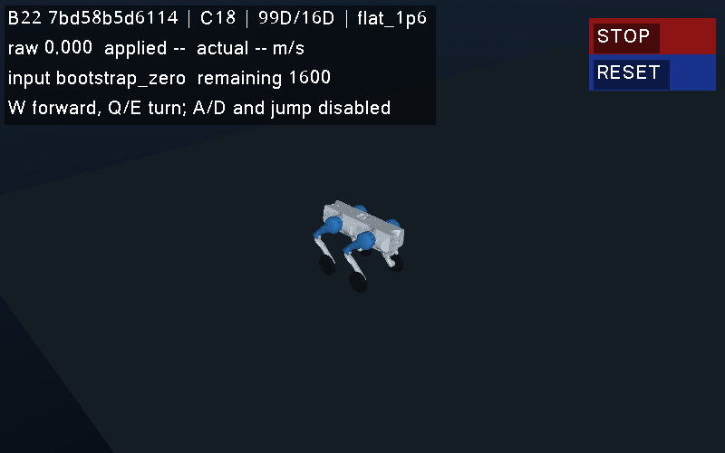
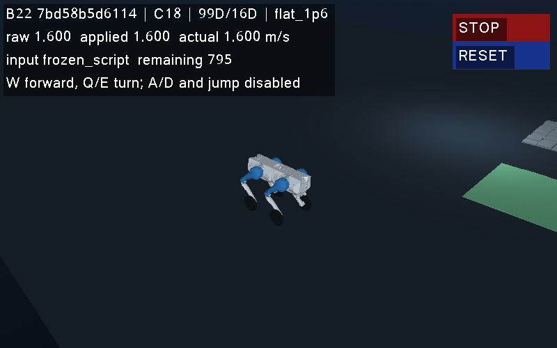
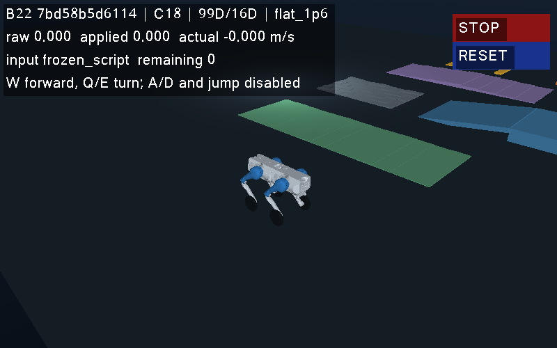

# B22 v27 单次 GUI 与固定控制收尾结果

2026-10-18，本机 v27 环境的真实 GUI 与 `flat_1p6` 固定直行/停车演示 **PASS**。执行和独立读回均通过，没有训练、自动重试或第二次物理运行。所有者指令是“完成收尾工作”，范围延续此前明确的新版 GUI/控制演示验收。

执行源提交为 `1bc78059d7be639c09f8617cd813d337a13d7e4a`。该提交中的 [运行器](../scripts/run_b22_closeout30.py)、[只读核验器](../scripts/verify_b22_closeout30.py)、[32 项合成测试](../tests/test_b22_closeout30.py)和[运行前范围说明](b22_closeout30_20261018.md)保持原字节；后者的“尚未启动”是运行前状态，此结果页在实际执行之后新增。原 v27 manifest、launcher、host、worker、checkpoint 和历史结果没有改写。

## 实测结果

| 项目 | 本次观察 |
|---|---|
| 固定任务 | `flat_1p6` / actor B / seed 181202 / C18 基控 + 16D 残差 |
| 控制与物理 | 1,600 控制拍；8,000 正常 native 返回；2 次编译 native 返回；C 违规 0 |
| 结束 | 16 s 仿真，`time_limit`；terminated=false、truncated=true；无 reset、无 warning |
| 模型调用 | load 1、torch_load 3、predict 1,601（1,600 控制 + 一次 32 行 probe）；训练/反传/保存 0 |
| GUI | X11 窗口 52428811；199 render frames；3 张 800×500 RGB PNG 解码及像素 SHA 通过 |
| 持速 `[495,895)` | 400 拍；均速 1.601452375 m/s；RMS 误差 0.004795820 m/s；100% 的拍 >1.5 m/s |
| 停车 `[1500,1600)` | 100 拍；平均 |vx|=0.000207448 m/s；平均 |wz|=0.000221497 rad/s |
| 姿态净空摘要 | 末秒净空人口标准差 0.000024272 m；控制采样最小净空 0.454685056 m |
| 资源与收尾 | 整体 56.319 s（上限 900 s）；最低 sampled effective RAM 7,267,708,928 bytes（约 6.77 GiB）；无遗留子孙进程 |
| 证据读回 | 20 份原子归档的 payload 字节与 SHA 一致；1,601 个状态端点及 1,600 条控制记录完整 |

持速与停车数值沿用冻结 `rl16_heldout_score_08.py` 中的相关阈值，未为本次结果调整门槛。速度是从保存的 COM 状态计算所得，不是用目标值替代测量。RAM 是每秒采样，不是独占或预留承诺。

## 可查看的证据

紧凑机器回执：[reports/b22_closeout30_20261018.json](../reports/b22_closeout30_20261018.json)，固定原始监督、来源、v27 completion、host/worker 和轨迹等身份；三个随报告保存的截图是原文件的字节复制，SHA 与原始 GUI 记录一致。

| 初始：0 拍 | 行驶：805 拍 | 结束：1,600 拍 |
|---|---|---|
|  |  |  |

三图已逐张只读查看：机器人和 HUD 清晰，进度从 0 到 805 再到 1,600；行驶图的 raw/applied/actual 为 1.600，结束图命令为零、实际速度约零。没有注入按键或鼠标，截图不证明人工操作、窗口失焦清零或故障响应。

原始证据仍保存在本机以下新目录中，未覆盖历史记录：

- `results/b22_v27_closeout_20261018_01/`：状态、控制/原生轨迹、session、host/worker、render 与三图。
- `results/b22_v27_closeout_20261018_01_launch/`：v27 来源 GO、readiness、request 与 completion。
- `results/b22_v27_closeout_20261018_01_closeout/`：本轮 owner 范围、资源采样、stdout 和最终监督/读回报告。
- `results/b22_v27_closeout_20261018_01_reservation.json`：本轮预约已关闭。

原 launcher 的运行前登记核验了 4,072 项、4,053,653,469 bytes 的输入身份；host 的 preflight 对共享 session 中 4,075 项来源进行了全 SHA 检查，host 退出时 `source_mismatches=[]`。新读回器核验自己的固定执行源、完成链与本次产物；它没有重新独立扫描全部约 4 GiB 的系统/历史输入。

## 入口与范围

无执行地查看收尾计划：

```bash
rtk proxy /usr/bin/python3 -B scripts/run_b22_closeout30.py
```

本次唯一 `--execute` 已使用，其固定输出拒绝覆盖，不能用它自动重跑。操作者以后明确要启动常规演示时，仍使用 [v27 入口](b22_runtime_v27_20261016.md)：

```bash
rtk proxy /usr/bin/python3 -B scripts/play_b22_v27.py --check
rtk proxy /usr/bin/python3 -B scripts/play_b22_v27.py
```

这次结论仅为更新环境上的一个固定 GUI/控制演示。`qualification_granted=false`；未重新授予六任务、完整 native 接触力/停车最大 excursion、坡道/台阶、镜像转向、键盘或实机资格，也没有改变 `RL_contribution_passed=false` 的历史结论。它不能支持多种子稳定性、泛化、RL 超过零残差或 sim-to-real。

32 项合成测试与三份新 Python 文件的 Ruff 检查在执行前已通过；独立只读审查也已完成。正式验收没有安装依赖、改系统库、替换权重或修改冻结源码。后续若要扩大任务，应另列范围、预算和新输出，不能把本次 PASS 外推。
