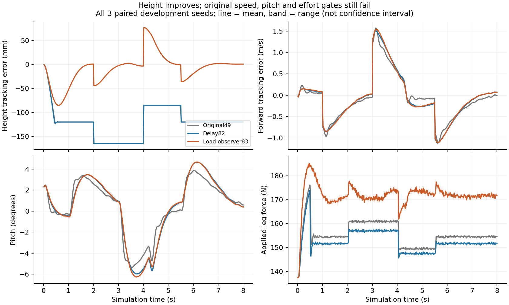

# 83：修正采样时相、估计 MPC 负载，并保留性能失败

本轮实际增加了采样源、负载扰动 MPC、参考力矩检查器和资源监督器，并运行两个三 seed 开发预检。高度控制出现明确改善，但没有候选取得替换默认控制器的资格。没有新增训练；48 归档与 v27 不变。

## 控制结果

| 新实现 | 实际验证 | 结论 |
|---|---|---|
| 独立 MjData 的同时间传感采样 | 12 例终止留证，8 例跑满、4 例跌倒；0 partial | 共同跑满的 3 对跟踪 RMSE 为 0.284070 → 0.214971 m/s（−24.32%）；两臂各 4/6 跑满，不能推广到全部案例 |
| 标量负载扰动观测与一致平衡点 | 12/12 完整，4,800 控制间隔、48,000 积分步、4,812 次求解 | 相对原49，高度 RMSE −74.42%，但速度、姿态与力成本门失败，拒绝完整对照 |
| 固定参考的必要力矩条件 | 原参考 3,000 区间，独立算式与工具交叉核验 | 1,512/3,000（50.4%）超出 2 Nm；峰值 2.90449 Nm。不是 RMSE 下界或实机辨识结果 |

图使用全部三个已注册开发 seed 的失配轨迹；线为均值，阴影为极差，不是置信区间。新增模块是 [OffsetMPC83](../src/wheel_legged_control/offset_mpc83.py)，运行定义是[预注册](experiments83/offset_mpc83_preregistered.json)。共同 Delay82 基线高度 RMSE 为 125.2893 mm，新候选为 32.0313 mm；相对原49，各项比值如下。

| 失配指标 | 相对原49变化 | 原门 |
|---|---:|---|
| 高度 RMSE | −74.4222% | 至少改善10%，通过 |
| 前进速度 RMSE | +8.5108% | 最多恶化5%，失败 |
| pitch RMSE | +16.8544% | 最多恶化5%，失败 |
| pitch 峰值 | +16.8231% | 最多恶化5%，失败 |
| 归一化 effort RMS | +10.2202% | 最多恶化5%，失败 |
| 轮力 RMS | +5.1407% | 最多恶化5%，失败 |
| 腿力 RMS | +10.5529% | 最多恶化5%，失败 |

候选最大单回合求解 P95 为 0.61394 ms，低于20 ms门。相对共同 Delay82，effort 与腿力仍分别增加11.8652%和12.6948%，所以不能借换用较差基线取得资格。六条新基线的13个物理/命令/奖励列与82归档逐数值一致，不含求解耗时及新增测量/噪声列；FIFO、名义 A/B、Q/R/H/终端矩阵保持和独立指标核验通过。输入成本中心随估计平衡点移动。完整20 seed对照未启动。

唯一控制机制是用名义模型创新和实际延迟后施加力估计垂向等效扰动，固定 tau=0.2 s、限幅±60 N；前后任一测量伸缩位置绝对值达到0.115 m即冻结。估计平衡点同时用于预测、输入成本中心、相对约束和 warm start，未读取真实失配质量或接触力，未调 Q/R/H。设计参考[线性 offset-free MPC](https://www.sciencedirect.com/science/article/pii/S0005109809002969)中扰动估计与稳态目标一致处理的思路；本对象包含非线性、延迟和增益失配，不声称满足该论文的零稳态误差保证。

## 采样修复的作用与边界

[新采样源](../src/wheel_legged_control/d1/coherent_sensor83.py)只刷新独立数据副本的派生量，使关节量、IMU与接触标记对应同一个采样时刻。测试直接复现了旧路径积分后 q/dq 与上一个物理子步派生缓存混用的问题，并验证读取不会改变真实积分状态或 warm start。被控模型的 legacy 时相、估计器 Jacobian 分支、噪声随机流、20 ms 延迟和控制器均保持原样；不加入外推补偿。

[12例预注册](experiments83/coherent_sensor83_preregistered.json)的六条旧基线精确复现。所有保存测量的离线估计重放逐位一致。原聚合预检门通过，但 `no_extra_falls` 只比较跌倒总数：noise/seed43 新方案跌倒，而旧方案跑满；bias/seed17 则相反。bias/seed29 两臂均跌倒。共同跑满子集只有 noise/17、noise/29、bias/43，24.32%的改善仅指该子集。完整评测未运行，`performance_qualified=false`。

实际消耗为4,592个任务控制间隔、22,960个积分步，另有冷启动名义辨识的511个辅助控制间隔、2,555个积分步，合计25,515个积分步。辅助辨识单独记账；不能只报告任务积分数。实验CPU为31.997 s，MPC为8.092 s。单元测试消耗另列，不包含在这些正式预检计数内。

## 工程修复

- [参考力矩检查器](../src/wheel_legged_control/reference_feasibility83.py)显式使用完整 N+1 参考样本与固定隐式离散动力学，返回逐区间必要力矩和超限比例。它不修改参考或限幅；条件满足也不证明延迟系统能跟踪。旧轨迹的积分项没有在饱和拍同向加剧饱和，故本轮不凭猜测新增 anti-windup 或前馈缩放臂。
- [资源监督器](../scripts/run_pressure83.py)在原有效内存条件外检查祖先 cgroup 的 PSI 和本单元 reclaim/max 事件。旧“可用字节够即准入”的缺口已用红测试复现。真实孤儿与超时探针验证了独立进程组子进程的回收；pidfd及 cgroup 归属核对限制清理范围，未停止其他程序。
- 所有重任务串行，Nice10、单CPU/数值线程、MemoryHigh2G、MemoryMax3G、swap0；启动4GiB持续10s、运行保留2GiB。PSI策略只收紧准入，不能保证系统永不发生内存压力。

本仓新增专项测试123项通过。冻结来源在执行前核对81的1,390项、49的17项及82的32项绑定；v27 SHA仍为 `d3c38429362e82745179f2c526b2ee52d805526df390d52346c805e5a51fff09`。独立读回、全部失败与资源回执见 [83汇总](../reports/project83_results_20261104.json) 和 [证据包](assets/project83/)。本轮正式控制实验合计73,515积分步、0训练更新，不授予实机或跨任务控制性能资格。

还未解决的是：延迟和有偏测量下的全案例稳定性；恢复支撑力时速度、姿态和 effort 的耦合退化；原高频 PI 参考在固定力矩限制下不可精确实现。下一步需要分别检验这些机制，不能靠放宽门槛或挑选 seed 宣称完成。
