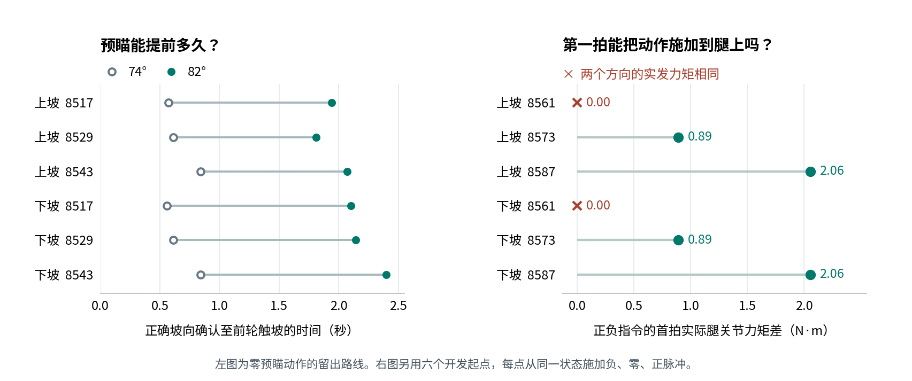

# 第 85 轮 · 前视测距与前后轴支撑的两项短仿真

2026-11-20。在 ±4° 坡上，只改变最近一束测距的俯角，就使六条留出路线都更早确认了坡向。另一组独立起点检验了机器人能否执行一记很小的前后轴支撑变化。六处中有两处的正负指令在第一拍产生了相同的腿关节力矩。六条零预瞄动作基线也都未走完触坡后的 0.40 m。按事先登记的三项条件，本轮训练更新为 **0**。[上一轮视频与失败记录](terrain_preview84_results_20261119.md) · [训练前验证方案](terrain_preview84_rl_followup_20261119.md) · [预注册协议](experiments85/terrain_action85.json)



## 机器人在触坡前多久能看清坡向？

两组虚拟传感器同时观察同一条轨迹，安装均前移 16 cm，只把最近束由向下 74° 改为 82°。保留 6 Hz 采样、40 ms 传输延迟、250 ms 测量有效期、20 ms 延迟的带噪本体估计，以及原控制器、力矩和跌倒限值。首次确认要求同一新鲜测量包在连续三个 100 Hz 控制周期覆盖两条轮迹，估计坡度方向正确且幅度至少 0.5°。表中提前量从第三拍算到前轮首次带载触坡。两种测距都没有驱动本组动作。

| 工况与种子 | 前轮触坡（s） | 74° 提前（s） | 82° 提前（s） | 触坡后前轴最远越过坡脚（m） | 基线结局 |
|---|---:|---:|---:|---:|---|
| 上坡 8517 | 2.67 | 0.57 | 1.94 | 0.1014 | 走满 6 s |
| 上坡 8529 | 2.71 | 0.61 | 1.81 | 0.1359 | 走满 6 s |
| 上坡 8543 | 2.97 | 0.84 | 2.07 | 0.2608 | 3.86 s 跌倒 |
| 下坡 8517 | 2.67 | 0.56 | 2.10 | 0.2462 | 走满 6 s |
| 下坡 8529 | 2.71 | 0.61 | 2.14 | 0.1690 | 4.15 s 跌倒 |
| 下坡 8543 | 2.97 | 0.84 | 2.40 | 0.3816 | 4.34 s 跌倒 |

旧录像的 308 个不重复捕捉姿态中，两条轮迹都有真实地面支撑且坡度读数有效的帧从 **80/308（26.0%）增至 202/308（65.6%）**。这项几何读回允许用捕捉时真实姿态校正倾角。新路线的在线估计只使用当时可用的延迟带噪姿态。182 个已送达的包中，到达当拍就能用的从 **41 增至 118**，在有效期内至少有一拍能用的从 **86 增至 151**。每个包在各自计数中只算一次。

两种安装都在 **6/6** 个工况达到预注册的三拍确认条件；82° 的首次确认全部更早。事后用原来四个射线命中端点的世界坐标核对，两种角度各自的六个首次确认窗口都得到真实地面几何支持。下坡 8543 仍各有一个触坡前错向包。统计整段时，74°、82° 分别有 14 和 18 个包曾在至少一拍报错方向。更早能看见坡不保证每个读数都正确。[逐路线与测量包复算](assets/project85/independent_audit.json)

前轴最远推进使用原评分量 `front_track_x_m`。下坡 8543 离终点只差 1.84 cm，随后跌倒。六条原评分窗口均缺失，无法报告完整入坡窗口的俯仰 RMSE。[原始轨迹](assets/project85/recordings.zip)

## 同一个物理状态下，正负支撑脉冲能否产生不同的实际动作？

另用三个开发种子和两个坡向，在前轮带载、位于坡脚前 5 cm 内时存档。每个起点还原同一份物理、控制器、传感器队列与随机数状态，然后分出负、零、正三支。前 16 拍请求在前后轴之间转移 ±9.4464 N（整车重力的 2%）或 0 N，随后 48 拍撤去请求。下表的力矩差是正负两支在首拍实际腿关节力矩的最大分量差。误差比较使用三支均已真实触坡后的相同相对拍号。

| 工况与种子 | 首拍实际分配，负 / 正（N） | 首拍力矩差（N·m） | 共同窗口（拍） | 俯仰 RMSE 正减负（°） | 动作验收 |
|---|---:|---:|---:|---:|---|
| 上坡 8561 | 0 / 0 | 0 | 53 | −0.1447 | 失败 |
| 上坡 8573 | 0 / +9.2781 | 0.8927 | 64 | −0.0895 | 通过 |
| 上坡 8587 | −9.4464 / +9.4464 | 2.0556 | 35 | −1.6719 | 通过 |
| 下坡 8561 | 0 / 0 | 0 | 53 | +0.0959 | 失败 |
| 下坡 8573 | 0 / +9.2781 | 0.8927 | 64 | +0.2838 | 通过 |
| 下坡 8587 | −9.4464 / +9.4464 | 2.0556 | 35 | −1.3337 | 通过 |

**18/18** 支走满 64 拍，分支内零跌倒、零力矩越界。六个起点都测到实际轮地法向载荷变化和超过 0.01° 的共同窗口误差差异。变化方向随起点而异。首拍正负实发力矩有差异的为 **4/6**，两个符号都能在首拍实际分配到力的仅 **2/6**。外加脉冲测出了动作对姿态的影响；这里没有训练策略，也没有测出闭环越坡收益。[力分配和实发扭矩](../scripts/terrain_preview85_action.py) · [逐起点复核](assets/project85/independent_audit.json)

### 种子 8561 为什么失败

两坡的触发首拍，左前、右前、左后、右后腿的名义支撑依次为 **307.008、0、250.256、0 N**，单腿上限为 **307.008 N**。现有分配器让同轴两腿等分修正。向前转移时，左前腿已达上限，右后腿也没有力可减。反向转移时，右前腿没有力可减。两个请求都在进入物理引擎前变成了零，直到第二拍才见到 0.6793 N·m 力矩差。

用首拍支撑量还能直接算出一种替代分配的上限。固定每一侧的前后支撑力总和，允许左右两侧转移量不同。每侧能向前转移的最大量是“前腿上限余量”和“后腿已有支撑”的较小值；反向同理。两侧相加，三个种子的可行区间依次为 **[−56.75, 0.00]、[0.00, +28.59]、[−171.49, +195.48] N**，同种子在两坡的首拍相同。这是对名义支撑的离线算术上界，真实轮地接触和横滚响应仍需验证。在前两种姿态，单改左右分配也只给一个方向留出余量。

## MotrixSim 可以补哪两项验证

1. **独立验测距。** 官方技术报告第 4 章给出直接查询碰撞几何的传感器，CPU API 提供最近射线命中和无时间推进的正运动学。可先在另一引擎逐帧载入这 308 个姿态，用同一原点和方向跟踪首先命中前腿还是地面。应先确定最近遮挡，再应用本项目的 0.14 m 最小量程，最后比对双轮迹有效位和首次错向帧。这样能在零积分预算下检查遮挡结论对模型导入和射线实现的敏感性。[官方技术报告](https://motrixsim.motphys.com/) · [MotrixSim CPU 射线接口](https://motrixsim.readthedocs.io/en/latest/api_reference/core/motrixsim.html#motrixsim.SceneModel.raycast_closest)
2. **独立验动作后果。** 第 2 章分别给出接触、滚动摩擦与车辆标定案例。Motphys 的 Uni-SuperMimic 是 G1 全身跟踪的独立复现，可在相同策略和数据配置下切换 MuJoCo 或 Motrix。轮足可以借用它的观测和动作接口校验，先核对资产、单位、关节顺序、时间步和延迟，再向两个后端输入相同的已施加力矩。按各自的首次带载触坡对齐，比较逐轮法向力、前轴推进和俯仰响应的方向。当前两处失败的力矩在分配时已归零，跨引擎比较最值得先看有实发力矩的四处。本轮仅执行 MuJoCo，Motrix 的 D1 结果仍待实测。[接触传感器与坐标系](https://motrixsim.readthedocs.io/en/latest/user_guide/kinematics/sensor/contact.html) · [Uni-SuperMimic 固定版本](https://github.com/Motphys/Uni-SuperMimic/tree/70e16ac3dafb81aae9e658e798f035675a396868) · [跨后端策略接口检查](https://github.com/Motphys/Uni-SuperMimic/blob/70e16ac3dafb81aae9e658e798f035675a396868/src/unisupermimic/sim2sim.py)

优先定位零动作基线的推进损失，可用同一轨迹把车体位移、轮速、承担法向载荷的车轮和跌倒时刻对齐。动作接口另需验证有双向余量的控制时刻。两者均可先查已有记录。后续 PPO 和 SuperMimic 式学习可以共用同一奖励、观测和实发动作接口，再比较策略更新方式。

## 复算与资源

预注册提交 `029e771` 先于数据采集。原始包收录全部 116 个文件，包括逐拍记录、分支初态、实验终止原因和系统资源日志。独立检查器用 Python 标准库从原始光程、姿态、16 轴力矩和接触记录重建验收结果，复算新增物理步为零。原始包 SHA-256 为 `68925eb753a4c863d842dff87db3c9995614faf0907341763b8b8983c658ae97`。[原始包，4.45 MB](assets/project85/recordings.zip) · [独立复算 JSON](assets/project85/independent_audit.json) · [复算源码](../scripts/audit_terrain_preview85.py)

全程单 CPU 核、单线程、单物理环境串行。一次辨识 511 拍，留出路线 3,035 拍，开发前缀 1,514 拍，18 条分支 1,152 拍，合计 **6,212/7,152** 控制拍、**31,060/35,760** 个原生物理步。正式单元含准入观察共 34.39 s，放行时有效可用内存 6.16 GiB，运行最低 4.94 GiB，组内峰值 0.89 GiB。守护日志确认 Nice 10、MemoryHigh 2 GiB、MemoryMax 3 GiB、swap 0；OOM 事件为零。实验按协议完整结束，所有跌倒记录均已保留。

在仓库根目录解压到新目录即可复核，输出文件使用独占创建。

```bash
unzip -q docs/assets/project85/recordings.zip -d /tmp/terrain85-readback
python3 scripts/audit_terrain_preview85.py \
  --sensing /tmp/terrain85-readback/trials/sensing \
  --action /tmp/terrain85-readback/trials/action \
  --offline /tmp/terrain85-readback/trials/archive \
  --run-summary /tmp/terrain85-readback/trials/summary.json \
  --output /tmp/terrain85-readback/recomputed.json
```
