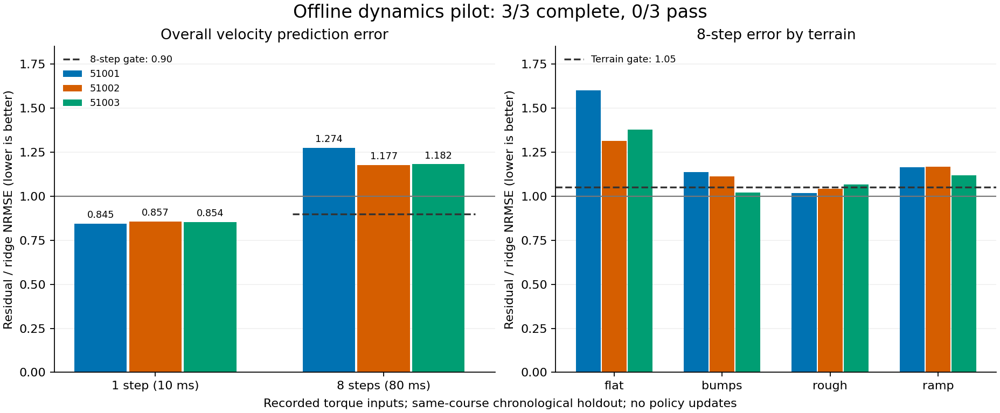

# 51 离线动力学小验证：一步改善，多步恶化

2026-10-30。**执行 COMPLETE，3/3 完整；候选 0/3 通过，停止策略训练。**

[运行前协议](world_model51_preregistration.md) · [完整机器摘要](../reports/world_model51_results_20261030.json) · [数据准入收据](../reports/world_model51_data_20261030.json)

唯一变量是给固定 ridge 预测器增加 2×64 tanh 残差。课程、奖励、策略、冻结控制器和 v27 均未修改。预注册与实现先提交为 `6033ee0f1388b39e8dab5bcca08fefdb106737fc`，再开始唯一正式执行；没有选 seed、改门槛、补跑或续跑。

## 测试结果

主指标是 22 维速度的归一化 RMSE，先按回合计算再等权平均。h1 为 10 ms，h8 为 80 ms；后者递归传播预测状态，未来力矩使用记录值。以下不是速度跟踪误差或策略闭环成绩。

| 模型初始化 | h1 NRMSE | 相对 ridge | h8 NRMSE | 相对 ridge | 总判定 |
|---|---:|---:|---:|---:|---|
| ridge 基线 | 0.245118 | — | 0.649480 | — | 固定对照 |
| 51001 | 0.207198 | -15.47% | 0.827616 | +27.43% | 未通过 |
| 51002 | 0.210156 | -14.26% | 0.764443 | +17.70% | 未通过 |
| 51003 | 0.209218 | -14.65% | 0.767376 | +18.15% | 未通过 |

三初始化的 h1 平均为 **0.208857（−14.79%）**；h8 平均为 **0.786479（+21.09%）**，最小 0.764443、最大 0.827616、极差 **0.063173**。全部 24 个“模型初始化 × 测试回合”组合的 h8 误差均高于基线。

图展示全部初始化，横线为原门槛；[绘图脚本](../scripts/plot_world_model51.py)只读保存的 JSON，不重新拟合。

## 失败项

预注册要求每个初始化同时满足 h1 比值 ≤1.00、h8 ≤0.90、各地形 h8 ≤1.05。三个初始化的一步门全部通过，但整体八步门全部失败。分地形八步比值如下：

| 地形 | 51001 | 51002 | 51003 |
|---|---:|---:|---:|
| flat | 1.6014（失败） | 1.3136（失败） | 1.3771（失败） |
| bumps | 1.1359（失败） | 1.1134（失败） | 1.0211 |
| rough | 1.0165 | 1.0409 | 1.0661（失败） |
| ramp | 1.1635（失败） | 1.1687（失败） | 1.1185（失败） |

不是执行失败，也没有 partial 冒充完整模型。源策略的 `qualification_granted=false` 仍保留；这里只使用其执行完整的日志作为动力学数据。初始 Ruff 检查发现的导入顺序、字典写法和异常处理标注问题均在封存前修正；它们不计作实验尝试。没有正式任务失败或重试。

## 数据、资源与验证

- 固定读取 47 的 120 个压缩文件（176,620,014 字节），24 个完整回合、24,000 条转换；train/validation/test 各 8000 条。源哈希、连续性、闭合记录和全部 5 个子步的执行器直通检查通过。排除不完整回合 32，没有读取或重跑 48 的归档数据。
- 三个模型各 2000 次更新，总计 **6000 次模型更新、0 次策略更新、0 新物理步**。最终模型均保留，Torch→NumPy 导出最大绝对差为 1.91e-6，低于注册的 1e-5。
- 实验 CPU **25.10 秒**、程序墙钟 **28.71 秒**，含内存准入的监督器墙钟 **41.33 秒**。Nice10、单 CPU、单线程；MemoryHigh 2 GiB / MemoryMax 3 GiB / swap0。有效可用内存最低 **8.979 GiB**，组内峰值 **0.924 GiB**，无 OOM 或内存限额事件，没有停止用户程序。
- 新原始结果实际共 **19,952,700 字节（19.03 MiB）**。原始 `artifact_bytes` 在写报告前计数，为 19,838,810；公开摘要另记包含报告自身的准确总量。源数据、三个模型和监督日志保留本机；Git 提交源码、小型收据和图，不加入大轨迹。
- 六项边界单测通过，覆盖后状态泄漏、非直通执行器、partial/重置拼接、真实八步递归、训练组标准化隔离，以及分地形/近零/非有限值拒绝规则。Ruff 通过。另一只读审查按保存 JSON 独立复算了回合、地形、总体均值和门槛，未重新训练。
- 24 个冻结文件、4 个实现文件和4 个源元数据的 SHA 均保持一致。v27 的 SHA256 仍为 `d3c38429362e82745179f2c526b2ee52d805526df390d52346c805e5a51fff09`。

## 尚未解决

数据来自同一个 PPO 训练流，课程模板和同地形初态重复；oracle 输入没有测量噪声。三个模型初始化不是三个独立环境或策略训练 seed，结果不能解释为新课程、噪声或未知地形泛化。45D 状态还遗漏求解器 warm-start 等状态。

一步拟合改善未能转成多步改善。当前证据不能区分一步训练目标、未建模状态或递归分布变化各占多少影响，也不能否定完整 SuperMimic。若未来继续，应另行预注册一个固定数据、固定网络、只改变一步/多步训练损失的离线对照；本轮没有执行它，也没有启动策略反传、课程/奖励改动或 D1 导出。

本轮支持的决定是保留现有演示和控制路径，**不把这个候选接入主线**。D1 的接口与适用边界见[关联说明](https://github.com/LYHrmer/ddt-d1-rl-lab/blob/main/docs/supermimic51_offline_scope.md)。
